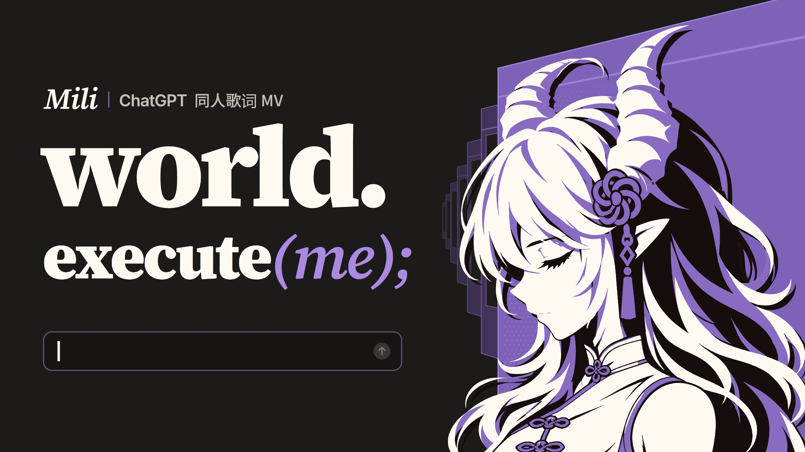
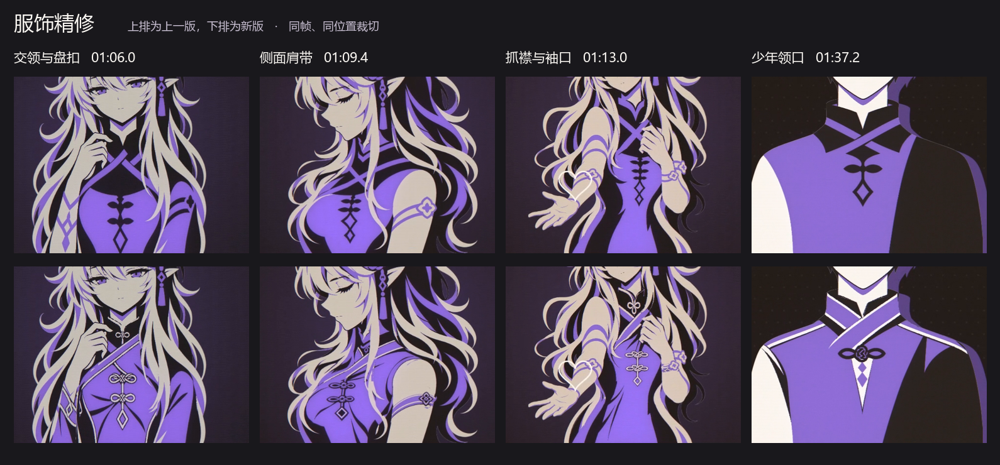
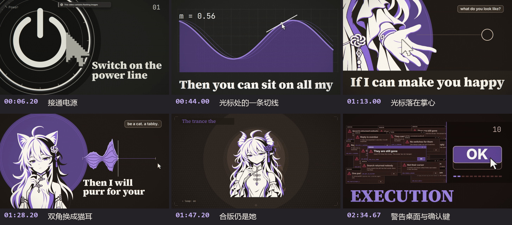
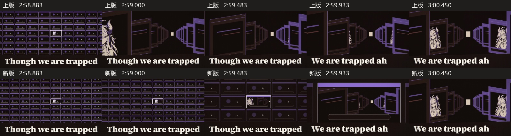
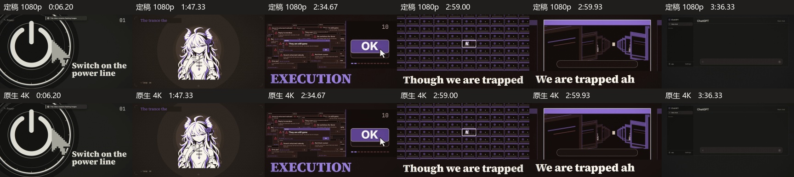

# 《world.execute(me);》制作手记与提示词

[制作过程](#production) · [播放器时间表](#player-map) · [审片原话](#user-quotes) · [十二条复现提示词](#prompt-pack) · [美术提示词英文全文](#art-originals)

## 定稿从哪里看起

《world.execute(me);》是 Mili 的作品。这支同人歌词 MV 把演唱者放进 ChatGPT 对话里。前半段，用户点到哪里，她就在那里给出回答。后半段，她还有能力发送，回复栏却一直空着。两次副歌都拍同一只摊开的手，让观众从光标和掌心的距离看出关系变了。



**本手记对应 2026 年 11 月 18 日审定的「显像／折页·窗内走廊」版。** 全片 71 镜，含 5 秒片头警告页，原生 3840×2160、60 fps，画面 3 分 36.900 秒。识别这一版有三个位置。1:47 是长发双角女性，2:34 是左边警告桌面与右边放大的 OK，2:59 开始穿过唯一有人物的窗格。

**谁做了什么。** 创作者给出角色设定、视频参考，逐轮对带声小样做取舍。ImageGen 提供各姿势原画，工程把人物拆成墨版，以代码绘出界面、几何、字、指针和镜头运动，最后与本地原声合片。「审片原话」来自实际对话；十二条中文复现词按成片重新编写。美术制作时保存的英文全文在 Markdown 附录。

[4K 交付记录](records/delivery.md#master)　[1080p 审定记录](records/delivery.md#approved)　[71 镜逐镜分镜](storyboard.md)

<a id="production"></a>

## 从初版到定稿

| 制作阶段 | 做过什么，最后留下什么 |
| --- | --- |
| 勘察项目初版 | 以 `preview_1080p60.mp4` 校准风格。先列当时的 87 镜、切点和已有绘制能力，再选出值得重建的段落。保留了原片的聊天界面语法、衬线排印，以及动作落在人声或鼓点上的习惯。 |
| 用局部小样试语言 | 在圆、波、极限三镜试出「光标量到哪里，画面就报告哪里」。白纸校样先做一张冲击最强的试印，再让原印与损坏的重印在两次副歌呼应。旧轮次的橙墨、裂缝和刻度数量是当时的设计记录。 |
| 统一角色与颜色 | 身份和花结换成 ChatGPT。先用三块墨认出同一个角色，再按设定表和参考影片逐姿势精修脸、衣领和手。把代表她的中间墨映成紫色，茄子、番茄、果柄各用自己的专色。 |
| 整片做几次独立试剪 | 回执版、轮转版、折页版、显像版各自保留入口。折页版探索纸张和窗廊的空间，显像版改用接点、扫描、接收波形开场。《对话的两端》和《回车之后》也曾独立导片。 |
| 在显像版上逐镜定稿 | 依次衔接叶脉与猫叫、首末掌心，校正 1:47 的女性形象，磨顺 1:34 的设置推近，补全 0:06 和 1:12 的光标。拼接前的前半段母片是 `preview_signal_cursor_1080p60.mp4`。 |
| 合并两部审片 | 取显像光标版的前段和 `preview_fold_1080p60.mp4` 的相应后段。第一稿在播放器 2:59.000 直接切；审片后改成围绕人物窗口连续推进四拍，在 1080p 带声片上确认，再原生导出 4K。 |

11 月 15–16 日定下了服饰、空接点、掌心遮挡、猫耳时长和聊天删档。17 日导出折页、显像等独立全片，18 日完成光标返修、合片与 4K 交付。最初的[勘察提示词](prompts/initial-survey.md)和[美术规格](references/art-spec.md)解释设计从哪里来；最终版本可对照[组合入口](examples/scenes/signal_fold.js)和[逐版验收日志](records/versions.md)。

**一次评审只回答一个问题。** 改动作时先交带前后余量的带声小样，在旧版和新版的同一帧缩到 240 像素宽并排。确认了，再把指定镜头放回全片。比如 1:47 的重画在逐帧核对用的 1080p 母片里只换了 167 帧，其余 12,847 帧解码像素一致。镜外回归可用 PSNR，完全一致时读数为 ∞。[女性人像同帧对照](images/portrait-comparison.jpg)

<a id="player-map"></a>

## 对着播放器看这支片

下表取播放器近似时间，便于拖动进度条。工程分镜和导出参数使用歌曲时间，歌曲零点在播放器 0:05.00；需要精确到一帧的地方还要计入工程的 `timing.offset = -0.15`。下文的实测帧号均从 0 起算。

| 播放器约 | 成片里的动作 | 接到下一镜的东西 |
| --- | --- | --- |
| 0:00–0:05 | 静音警告页和倒数。 | 暗场留给第一个电源触点。 |
| 0:05–0:34 | 像素箭头接通电源，选区拉开窗口，扫描线写出名字、显出她的脸；标题落印，用户输入并发送。 | 发送的亮点飞入坐标画面。 |
| 0:34–0:50 | 点阵结成球面；指针量圆边，在波形上落下一条切线，最后一个点落在极限线上。 | 上一镜的米白线垂成电线。 |
| 0:50–1:04 | 拔插 AC/DC、拨动机械快门、回翻日历跨过纪年分界，再进入 Codex 设置。 | 一连串画面变化都由用户的一次操作引起。 |
| 1:04–1:19 | 首副歌让人声进入波形、唯一通道和掌心；四次交互各留下印样，最后一张由 6×4 个窗口组成。 | 第三张印样留有光标刚刚落掌的痕迹。 |
| 1:19–1:34 | 茄子向叶脉送墨，番茄一滴封住扩散的斑。叶脉拉直成录音，双角换成猫耳，呼噜声被送出。 | 猫耳结束后回聊天，再次出场恢复双角。 |
| 1:34–1:49 | 设置推近，用户切换身份和昼夜。花结与指针先后牵引一根绳，扣出人像背后的圆。 | 两次错版与最后合版都来自同一张长发女性原画。 |
| 1:49–2:10.5 | 三个输入点显出最后的回复；她陆续发出六条不同的英文消息。活动信号变平，她擦掉尚未发出的草稿。 | 右侧留空，下一镜的空心接点提前半拍出现。 |
| 2:10.5–2:33 | 她尝试替对方上线，请求碰不到接点；重试催出一层层警告，桌面逐渐被盖住。 | 最上层警告把焦点交给 OK。 |
| 2:33–2:48 | 十二次人声各按一次 OK；六个数字占同一格。「6」清掉，空 0.30 秒，米白光标出现。 | 下一次发送从无人接收的状态开始。 |
| 2:48–3:02 | 末副歌重印前三张。原机位的掌心发出信号，在空接点外停半拍又折回；随后穿进人物所在的窗。 | 两列窗口围出有纵深的走廊。 |
| 3:02–3:17 | 回读的答复和折页叠起；方程描出心形，手掌、袖口留在黑词带后，指针越界。 | 离开的指针成为删档的操作者。 |
| 3:17–3:36.90 | 翻回双方的会话，打开删除确认，最后一声清空消息和侧栏标题。 | 末尾 72 帧停在同一张画面。 |

[逐镜时间、镜头 ID 与歌词行号](storyboard.md)

## 角色如何画、如何装进镜头



**先固定辨认点。** 用内置 ImageGen 逐姿势出图。设定表最左边的正面人物给出两只后弯的角、额前齐刘海、长发、太阳穴的小花结、高领长裙。早期先试无五官的剪影，定稿加入轻垂眼睑、鼻尖与很轻的嘴线。参考视频用来判断神情、手指和布料结构；朝向、裁口和接触点来自本片的姿势稿。

**再画光和衣服。** 青蓝底 `#29ABE2` 便于抠出透明区。素材用近黑 `#1D1B19`、砖橙 `#D97757`、米白 `#FAF9F5` 分版；近黑约占人物三成，是美术目标。背光侧发层、领内和交叠布料成整片暗面。交领压边有里外顺序，盘扣留出空隙，抓衣的手指下方才有受力衣褶。按设定补了独立垂袖与腰间绳结。

**按动作拆姿势。** 正面 `f_bust` 负责身份识别，低头侧脸 `f_profile` 也用于封面。伸手的 `f_reach` 先定位腕口、掌根和拇指，让四指在透视中错开，再标出掌心坐标。1:13 取回原头肩比例；猫耳稿保留精修服饰。少年保留两个短角，变猫时只切到对齐过的猫耳稿。单眼 `f_eye` 留作旧版素材，定稿两处空回复均留给界面动作。

**入片时重新上墨。** 归一化脚本按连到画布边缘的底色抠图，将人物归为三个墨版，再按镜头把中间墨映到紫色 `me`。在暗底、纸白和小缩图上看完，最后将手、脸或花结放回真实镜位核对。伸手位置来自素材目录的 `regions.json`，人物动过以后要重查锚点。

[角色原画提示词全文](prompts/character-originals.md)　[服饰精修提示词全文](prompts/costume-originals.md)　[分墨脚本](examples/art/prep_silhouette.py)　[掌心坐标](examples/regions.json)

## 让动作接得上



**一个点解释一整句。** 点阵、圆边、波形和极限共用一段连续的几何关系。正弦镜里用曲线上两个相邻采样点求方向，只画光标处的一条切线。图中的 0:44.00，斜率读数是 0.56。极限镜用同一采样点的位置计算高度差并除以 56；到达水平线，画面和读数一起停在 0.00。早期试镜里约 0.49 的冻结值属于上一种曲线。

**把变化挂在观众认得的部位。** 掌心镜让箭头尖落到掌纹，米白手上的箭头加连续深边。变猫时用下巴和花结对齐人像，收拢的叶脉原地接成呼噜波形。1:34 的镜头跟着设置里的 F 选项推近，用一段弧线送指针回到点击位。那一秒选项的最大单帧位移从 21.7 降到 10.3 个 1080p 像素。

**让两次副歌互为证据。** 第一次，光标从接点飞到她摊开的手上，压出掌纹。末副歌按同一掌心坐标、同一取景重拍，信号从她手里出发，在接点外等了 14 帧，再折回掌纹。四张原印依次取波形、单通道盘、掌印和窗口矩阵；末副歌只有三张重印，随后进入窗墙。

[几何采样](examples/scenes/signal_geometry.js)　[掌心配准与回程](examples/scenes/signal_hand.js)　[两次副歌掌心对照](images/palm-comparison.jpg)　[指针放大对照](images/cursor-comparison.png)

**拍点、字和墨。** 130 BPM，一拍约 0.462 秒，网格第 0 拍为歌曲 0.344 秒。剪辑用 `B()` 取小节、`Bt()` 取节拍、`T(i)` 取行首，必要时对照实测音头。她说话用 Source Serif 4，界面与用户用 Inter，系统数值用 JetBrains Mono。在线的 `me` 是 #7E62B8，变暖为 #8A6BC2；茄子、番茄、果柄分别取 #5F3A93、#D4432F、#4C7A3A。[时间与调色配置](examples/config.json)

## 十二次确认、四拍走廊、一次删除

**声音越密，越要让眼睛知道看哪里。** 先把第一只警告窗留到能读，后续弹窗沿半拍堆起来。定稿把桌面放左边、当前 OK 放大到右边，十二声各按一次，按键的下沉和回弹共用人声锚点。最后一次收走按键后，六个数字依次占同一回复位置。「6」消失后的 18 帧留空，然后才亮起一根常亮的米白光标。

**这里有两份真实的源码。** 当前源码里还留着「警告贴在六条消息旁边，每两声关掉一对」的聊天小样；另做过大字铺纸的高潮试剪。4K 成片用已审 1080p 逐帧比对过的十二键快照。复现大屏 OK 用下面的[审定版按键绘制](examples/scenes/approved_ok.js)；想研究另一种剪法可看[逐次关窗的对照图](images/warning-variant.jpg)。



**2:59 的接点是镜头运动的中途。** 第一稿在播放器第 10,740 帧换片，两边都是窗，人物却突然换了尺寸和位置。修订时先锁定唯一有人物的格子，旁边的窗一起放大。内侧贴上走廊最近的一幅人像，对齐发际与窗框；窗轨从镜头两侧掠过，观众这才看见尽头的门。底部歌词始终沿一条基线。1080p 修改区是 `[10724,10840)`，即 2:58.733–3:00.667，共 116 帧；余下 12,898 帧与硬切版逐像素一致。

**最后让删除动作承担结局。** 中段擦掉的是尚未发送的草稿，六次发送仍在历史里。片尾让观众从旧对话一路看到删除确认，在播放器 3:31.30 清空双方消息和侧栏；字幕与署名留足时间后，最后 1.2 秒连底纹也静止。封面对这点取了一个细节，让低头的她望向空回复栏。

[新旧转场逐帧对照](images/corridor-comparison.jpg)　[窗内推进的绘制](examples/scenes/signal_fold.js)　[片尾删除时序](examples/scenes/ending_history.js)

## 小样、4K 导出与复核

这份发布稿的示例命令沿用原渲染工程目录。仓库内的[源码摘录](examples/README.md)可用来对照算法。

**先跑小样。** 用工程目录作为工作目录，Node 负责分镜和渲染，本地 WAV/LRC 供应原声与词时。下面两条导出命令分别得到走廊同拍图和带声片段，参数为歌曲秒；`--start 173 --end 176` 对应播放器约 2:58–3:01。分镜与小样都显式指定定稿入口。

```powershell
npm run storyboard -- --edition signal-fold
node export/export.mjs --edition signal-fold --sheet out/remake_join.png `
  --times 173.73,174.0,174.8,175.65 --cols 4 --width 960 --height 540
node export/export.mjs --edition signal-fold --start 173 --end 176 `
  --width 1920 --height 1080 --fps 60 --cq 26 --out out/remake_join.mp4
```

**原生 4K 的实际路径。** 本机无头 Edge 用 Canvas 2D/WebGL2 在 4K 画布绘制，WebCodecs 编 H.264。定稿会话在加载时选用审定的 OK 快照。每帧等编码器取走画面再绘下一帧；末 72 帧复用同一张独立画面。最后从已审 1080p 片复制整条 AAC 音轨。留存的快照、捕获脚本和 1080p 审定片是复现此母版的输入。

**在本机以新名字复现。** 第一行渲染独立的 H.264 画面，后续命令封装带声 MP4。输入输出路径均相对于项目根目录，复现文件单独命名。

```powershell
node .probe/signal_fold_4k/gpucapture.mjs key 0 13014 remake_picture ack
$ff = '.\node_modules\ffmpeg-static\ffmpeg.exe'
$pic = '.probe/signal_fold_4k/remake_picture.h264'
$ref = 'out/preview_signal_fold_corridor_1080p60.mp4'
$tags = 'h264_metadata=colour_primaries=1:transfer_characteristics=1' +
  ':matrix_coefficients=1:video_full_range_flag=0:tick_rate=120/1'
$clock = 'setts=pts=N*256:dts=N*256:duration=256:time_base=1/15360'
& $ff -n -f h264 -r 60 -i $pic -i $ref `
  -map 0:v:0 -map 1:a:0 -map_metadata 1 -c copy -bsf:v "$tags,$clock" `
  -video_track_timescale 15360 -color_primaries bt709 -colorspace bt709 `
  -color_trc bt709 -color_range tv -movflags +faststart out/remake_signal_fold_4k60.mp4
npm run check -- out/remake_signal_fold_4k60.mp4
npm run check:lyrics
```

[捕获脚本](examples/export/gpucapture.mjs)　[加载哪个 OK 快照](examples/export/session.mjs)　[实际封装脚本](examples/export/mux.py)

## 怎么判断可以交片

| 检查对象 | 定稿实测 |
| --- | --- |
| 视频和声音 | H.264 High，BT.709，3840×2160，恒定 60 fps；AAC-LC，44.1 kHz 立体声。 |
| 长度、文件、耗时 | 13,014 帧，画面 216.900 秒；1,964,043,927 字节。原生画面渲染 359.2 秒，这个计时只含画面捕获与编码。 |
| 闪光 | 一般闪烁最差 1 秒窗口是 2.0 次，起于播放器 1:31.73；饱和红 0，单帧爆闪无。 |
| 音画同步 | 成片音轨相对原 WAV 偏移 0.00 ms。开机、第八小节落点、第九小节进入均误差 0 帧。工具另测得原 LRC 行首相对人声起音约早 70 ms。 |
| 版本与接点 | 4K 和已审 1080p 逐帧缩到 96×54 配对比较；音轨码流哈希相同。Edge 实播穿过 2:58–3:01 掉帧 0。 |
| 片尾与分镜 | 最后 72 帧解码后只有一种像素结果。71 镜含警告页，129 行均有镜头，缺行、离网格、缺叙事说明、后备均为 0。 |



**封面单独排印。** 取 `f_profile` 的三墨侧脸置于右侧，头向左下；左侧歌名用 Source Serif 4，米白的主体与紫色斜体后缀分层。下方保留一根米白输入光标。背景窗框从右侧往深处收，把空间留给分号和双角。成品为 3840×2160 的 sRGB JPG，755,177 字节，另缩到 320×180 看歌名和花结能否辨认。

[闪光与同步实测](records/flash-and-sync.txt)　[逐帧与音轨记录](records/4k-frames.json)　[封面原图](images/cover-4k.jpg)

<a id="user-quotes"></a>

## 审片原话

以下引号内均为本次对话中用户的原话或连续摘句。并排保留提出修改和随后审定的两句话，可以看出哪些要求后来变了。

| 讨论对象 | 原话 |
| --- | --- |
| 整体风格 | “项目初版 preview_1080p60.mp4 的聊天界面、排印与节奏” |
| 人物神态 | “沿用参考的精细五官和安静表情” |
| 头肩与服饰 | “头肩比例还是用上版的吧，猫耳服饰用精修版。” |
| 角色连续性 | “1分47秒应该是女性形象” |
| 动作接力 | “1:18–1:28 做茄子养叶、番茄止斑，1:40–1:47 做花结和指针轮流牵引，最后扣成环接上人像背后的圆。” |
| 接收端 | “2:09 那里先留空，切镜前半拍让下一镜右侧的空心接点提前出现，切过去时位置对齐。” |
| 无人应答 | “可以不用全发在吗，可以换一下话，另外字体应该小一点” |
| 十二声的初稿 | “十二次人声各按一次 OK，最后一次露出空回复栏，六个数字在同一位置依次出现，再接她的眼睛。” |
| 数数后的定稿 | “「6」消失后先空 0.3 秒，再在回复栏左边放一根细米白光标，常亮到切镜。” |
| 高潮试剪反馈 | “大字和纸张抢走了聊天界面” |
| 光标返修 | “1分12秒附近光标画的少了一块 6秒附近光标也少一块” |
| 删除会话 | “最后结尾那段可以做成在chatgpt的聊天界面把chatgpt与用户之前所有的聊天记录全部删除的画面” |
| 接片和审定 | “前面视频的2分59秒之后可以替换到后面视频的相应位置”　“过渡的太不自然了”　“这版可以” |
| 最后交付 | “导成4k 60fps”　“做一个合适的视频封面” |

最初整轮勘察指令另存为[第一轮提示词](prompts/initial-survey.md)。下面十二条由本手记整理，适合分轮复制。图像生成时保存的英文原文收在 Markdown 末尾。

<a id="prompt-pack"></a>

## 复现提示词 · 开工与角色

以下是整理稿。第 1 条先交给负责工程的助手，第 2–4 条配相应输入图使用。

### 01　给工程助手的第一轮

> 先读 AGENTS.md、docs/MINE/STATE.md，再对照定稿 4K、审定 1080p 和 signal-fold 分镜。列出每段的镜头 ID、歌曲时间、播放器时间、人物动作和接向下一镜的东西。用项目初版校准聊天界面、排印与节奏。先做时间表和同时间对照，等选中一段再动渲染。每帧只由 t 算出，随机取固定种子，歌词用 text(i)，颜色从角色调色板取。每次只交这一段带前后余量的带声小样。

### 02　给图像模型的女主母稿

> 输入第一张是姿势与裁口，第二张是角色设定表最左边的正面人物。画竖幅 2:3 的胸像，至少 1024×1536，下缘切到画布底。保留长直发、齐刘海、两只后弯的角、太阳穴小花结和高领长裙。神情安静，轻垂眼睑、简洁鼻尖、很浅的嘴线。青蓝纯底 #29ABE2，人物只用近黑 #1D1B19、砖橙 #D97757、米白 #FAF9F5 平涂。背光侧头发、领内、布料交叉形成整块近黑，约占人物 30%。发束以大小块相叠，双角、花结和下巴各有清楚的轮廓。无渐变、纹理、翅膀、尾巴、文字，输出单张角色稿。

### 03　给图像模型的服饰精修

> 以已审角色稿作第一输入，设定表和参考影片静帧只用来观察布料。沿原姿势修交领、高领和独立垂袖。交领画清前后两层，一道米白滚边沿翻折面走；盘扣的绳圈留孔，握衣手下的两道衣褶收向手指。黑墨用在领里、袖根和发梢下层。保留头肩比例、五官、双角、发结、手的外轮廓和原裁口。输出原尺寸，另看缩到 240 像素宽时领口能否读清。

### 04　给图像模型的姿势与变体

> 每次只画一个变体，附正面母稿和对应姿势稿。侧脸朝左下，用额、鼻尖、下巴的轮廓交代表情。伸手稿一手抚襟、一手向左下摊开，拇指有对掌关系，四指长短有序，手和发丝之间露出背景。猫耳稿对准母稿的下巴和花结，沿用精修服饰；少年稿用耳下短发、两只短直角和略宽的肩。每次叠回母稿检查脸、掌根和裁口，再交透明三墨版。

## 复现提示词 · 镜头与节奏

以下四条分别以一组相连镜头为制作单位；做完一组再审下一组。

### 05　开机、几何和设置

> 先近拍电源触点，米白箭头按下，打开选区、扫描出名字与人像，标题在重音上落定。发送亮点进入球面，球面边缘展开成波。光标落点只画一条切线，斜率由实际采样计算。极限点用同一 y 计算量尺和读数，锁定时真正在 L 线上。沿用 AC/DC 插线、同缝快门和跨纪年的日历，最后让用户在 Codex 式设置里把 GPT-6 Astra 从 Low 调到 Ultra，再点亮 1.5× speed。检查相邻镜头第一帧和最后一帧的连接。

### 06　首副歌与末副歌

> 让波形、唯一通道、掌心、窗口矩阵各承接一次互动，每次用一张白纸印样接住重词。紫墨属于她，米白指向用户；套准标记和 1/1 留在边角。首副歌让像素光标从空接点跳进她的掌纹，深边包住完整箭头。末副歌用相同掌心坐标重拍，波形在空接点外停半拍再退回手里。只重印前三张，随后进窗墙。交付两次掌心的同时间带声并排。

### 07　果实、变猫和错版人像

> 先让小叶蜷在用户手里。茄子把墨送进叶脉，叶片随重音张开；番茄的一滴抵住扩散的斑。把叶脉原位拉直，接成下一镜的呼噜录音。双角到猫耳时锁住下巴、花结和肩线，回聊天再恢复双角。后面的花结和指针轮流拉紧同一根绳，扣成圆接到人物背后。播放器 1:47 全程用长发双角的女性，两个错版重音和最后合版从同稿取墨。导 1:18–1:33 和 1:40–1:50 两段带声小样。

### 08　无人回应、警告与数数

> 她在同一聊天里发出六条不同的英文短问句，字比关键词小，另一侧一直空着。草稿可以退格，六条已发消息留在历史里。切镜前半拍先显出下一镜右侧的空接点。重试时警告按节奏铺满；用审定版左右分屏，左留桌面，右放大 OK。十二次人声各按一次，末次露出空回复栏。六个数在同一位置换，6 消失后空 18 帧，再放常亮的细米白光标。交 2:31–2:48 的带声片，在第一、六、十二声和空栏首帧核对。

## 复现提示词 · 合片与发布

### 09　给剪辑助手的接片指令

> 前段用 preview_signal_cursor_1080p60.mp4，尾段取 preview_fold_1080p60.mp4 的同一时间。播放器 2:59 附近对准显像窗墙里唯一有人物的窗格。四拍内把整组窗向前推，内部显出折页走廊，对齐两版人像发际、近窗边轨和远门的透视方向。字幕基线保持可读。先交 2:57–3:03 带声新旧对照，再比对改动区外的画面和完整音轨。

### 10　给结尾的指令

> 让问题页折向同一个答案。心形由方程描出；掌心、袖口一起藏在黑色词带后，只有米白指针越过心形。随后回 ChatGPT 聊天，能辨认双方说过话的历史，指针打开删除全部会话的确认窗，第四个尾音确认。末 1.2 秒完全静止，连粒子、底纹和输入光标都停住。用解码帧检查末 72 帧是否只有一个画面。

### 11　给导出与验收的指令

> 以 preview_signal_fold_corridor_1080p60.mp4 作审定母片。用 signal-fold 原生渲染 3840×2160、恒定 60 fps，十二次 OK 载入审定快照。复制母片的 AAC，逐帧缩图检查全片，按原尺寸查光标、脸和接点。交付前核对一般闪烁最差 1 秒窗口、饱和红、单帧爆闪、WAV 偏移、三个同步点及末 72 帧；给出文件大小和画面渲染耗时。运行该 edition 的 storyboard 并报告覆盖与后备数。

### 12　给封面排印的指令

> 用成片同一张 f_profile 侧脸、同一套紫墨和字体做 16:9 的 4K 封面。人物居右，低头望向左下的空回复栏，栏里只有一根米白光标。左侧排完整的 world.execute(me);，主词米白，(me); 紫色斜体；分号旁边留空。2:59 的窗廊退到人物身后，小字号注明 Mili 和 ChatGPT 同人歌词 MV。导 sRGB JPG，再以 320×180 检查歌名、双角与花结。

**原文入口。** 工程中保存了[第一轮勘察](prompts/initial-survey.md)、[角色逐姿势提示词](prompts/character-originals.md)和[服饰逐姿势提示词](prompts/costume-originals.md)。Markdown 的附录保留两组美术英文指令，便于直接拆出共用段和某一姿势段。

<a id="art-originals"></a>

## 附录 · 存档美术提示词全文

这里按制作档抄录英文指令正文。共用段与单姿势段配合使用，保留原英文大小写与颜色数值。输入图保留文件名或工程相对路径，省去三条只在原机器上有效的生成缓存路径。`f_eye` 是早期眼部试稿，供追溯替换过程。下方不同轮次的要求请配各自的输入图使用。

### 角色重画 · 制作档原文

使用内置 ImageGen，以姿势稿和用户指定的本地影片静帧为图像参考。原始图在 sources/，分墨后装入 assets/character/ 的八个同名 PNG。砖橙是中间墨版的分色标记，成片使用各场景的 me 色。

#### 女主五张定稿的共用提示词

> Production character redrawing for an animated print music video, a SINGLE isolated character asset, portrait 2:3 except the eye landscape. First image is the blocking and crop guide. Preserve character anatomy, broad silhouette, placement and orientation in that guide for compositing. Other references inform precision of the illustration, specifically the rhythm of large hair masses cut by slender tapered inner wedges, the silhouette of chin and ear, the ribbed horns, believable fingers, and reserved gentle performance. Make a new original drawing, zoom and composition from the first guide. Clean sophisticated limited-color Japanese screenprint, sharp untextured shape edges. Use only flat ink near-black #1d1b19, brick midtone #d97757, ivory #faf9f5 as mask channels; plain flat bright cyan #29abe2 removable background in ALL external/negative spaces. Keep roughly 30% near-black in the dark fabric, underside of hair, right shadow; good ivory-negative spacing. Large legible shapes with designed secondary cuts and fine accents selectively, no gradient, no noise, no code, subtitles, border, set, surface shading, labels or cast shadow. Dress and hair should be in separate masses.

#### f_bust

输入图（顺序）　pose_f_bust.png, bust_light_proof.png, study_73.3.jpg

> FIRST IMAGE IS THE GESTURE BLOCKING, not a reference for anonymous facelessness. The SECOND image is our final finished facial and costume model. Put her existing RIGHT HAND back in a natural delicate collar-touching pose shown in first and third references: on VIEWER LEFT, the forearm rises from the bottom left, lightly bent wrist, thumb and index elegantly hold the edge of the high cross collar just left of her throat, remaining three fingers lightly curved. Small but definitely visible, ivory hand in front of the midtone chest and dark collar, triangular brick wrist cuff as in first guide. Her viewer-left shoulder slopes naturally down toward the elbow. The full arm and fingers must be legible, use selective flat interior shadow cuts for palm structure, no spidery fingers. It is imperative the hand is in this finished portrait. Face and head and larger hair shapes match second image very closely; big uninterrupted ivory area on cheeks, gentle relaxed eyes. Preserve the dress with collar cross and chest frogs, anchor of right temple knot, head size, two horns and torso crop. Draw the figure as an elegant adult anime character with a reserved expression and correctly proportioned hand touching collar. No text, no UI.

#### f_profile

输入图（顺序）　pose_f_profile.png, f_bust 第一稿, study_184.jpg

> Three-quarter profile looking to the LEFT of the frame, head inclined slightly down; viewer sees the relaxed eyelid at true profile. Quiet presence and a real anatomical negative silhouette from forehead to nose tip to subtle lip and chin. Facial planes mostly ivory. Two curved ribbed horns in perspective, long flowing hair of varied lock widths, Chinese cross-neck dress, interlaced knot at visible temple with one hanging tassel. Maintain the pose and anchoring of image 1, same girl and dress as image 2. The silhouette and facial anatomy should look deliberately drawn; no hands in this portrait.

#### f_reach

输入图（顺序）　pose_f_reach.png, f_bust 第一稿, study_118.6.jpg, study_73.3.jpg

> Full nearly waist-high portrait, gently looking down to outstretched hand, ivory skin, only a delicate small lid shape and tiny mouth; same girl from NEW MASTER second photo. Anatomically clear OPEN right palm at lower left x18%, y83%, bare ivory whole palm and all fingers isolated by a narrow dark or brick cuff separating wrist from ivory forearm. One distinct thumb with proper opposition plus four gracefully bent fingers graduated naturally, tangible palm heel, accurate knuckles. Viewer sees a lightly cupped palm from three quarters, with fingertips pointed lower left at x0-15%. Keep generous cyan between fingers/hair and between hand and waist. Other hand gently touches collar strap, half-furled with finger joints natural. Preserve old anchors, including lowest left fingertip near x1%, y86%, knot on viewer right and both curved horns complete. Draw the fingertips as carefully as the face. Costume and hair of second image, pose/crop of first. Use nice rich rhythm of swept locks, correct anatomy.

#### cat_paws

输入图（顺序）　pose_cat_paws.png, f_bust 第一稿, study_73.3.jpg

> Frontal portrait of the same HORNED girl from NEW MASTER second image. Both delicately drawn HUMAN hands raised in front of the chest. Clean complete separation of all five fingers on each; slight asymmetry in wrists and flexion; gentle rounded finger pads, believable joints, dark skin fold or brick plane under one finger; do not overlap face. Keep both hands at the same level as the pose guide at chest height, enough contrast against bodice. Correct hand scale, gentle half-closed eyelids under long fringe, two backcurved horns, long hair, knot at viewer right temple, dress and collar from master. No animal paws or cat ears; technical asset name only. Keep the two palms ivory, facial skin ivory with a small brick underplane. Crop through lower bust as shown.

#### f_eye

输入图（顺序）　pose_f_eye.png, f_bust 第一稿, study_169.1.jpg

> Horizontal 3:2 extreme closeup for the near-end of the solitude shot. Treat it as a refined original cut-paper crop of the SAME girl's face as second master image. Use the first guide for framing and alignment ONLY: extreme crop through the face at top and bottom, one eye only, its iris centre at x42% y69%, eye corners about x28 to 60%, layered ivory-tipped bangs from forehead to cheek. At far RIGHT may show part of the rosette, black undersides, one cream lock in front. Tender calm attentive eye in profile-facing-left, a softly arched slightly lowered upper eyelid, relaxed outer corner, very short tapered lashes, no frown, no sharp wings, no angry upward tilt. A SINGLE solid midtone iris with small nearblack pupil softened under top lid. Forehead stays relaxed; underbrow minimal. Ivory skin, thirds of hair / flat color; make long curves immaculate, particularly the upper lash, at 4k zoom. Do not show nose/mouth or the second eye. No sparkle, registration, UI, code or captions. Eye alone on an otherwise tightly cropped face.


#### 变体三张末轮提示词

##### cat_bust
Reference 1 (before replacement): out/mine/character_redraw/sources/cat_bust.png
Reference 2: out/mine/character_redraw/sources/f_bust.png
transparent_background: false
Prompt:
> Perform the smallest possible edit to image 1, the specific portrait of both cat ears, NO horns. The cat ear inner fur color stays terracotta. Preserve the hand at the collar. Its framing, shape and all painted detail is locked. Image 2 is only a swatch for SKIN COLOR on the illuminated face. Edit image 1's FACE from a fully terracotta face to a porcelain OFF-WHITE skin base #faf9f5 to match image 2. Recolor main facial skin from the forehead underneath the bangs through brow, cheeks, temples, bridge of nose, entire chin and partially visible side ears in OFF-WHITE. Small orange iris and a tiny warm shadow detail, dark lashes, delicate mouth/eyebrows and a solid orange shadow immediately BELOW the jaw remain. Do not change character anatomy, expression, eye shape, hair, ornaments, clothing, scale, position or crop. Duplicate exact layout, same portrait 2:3 at 1024x1536, same clean three ink print illustration, same uniform cyan background. Image 2 must NOT introduce any of its pose, clothing, hair, horns, accessories or hand. All existing body, composition and rendering outside the face of image 1 should read exactly as image 1. Preserve a solid off-white face even in the wide expanse of both cheeks; compare with image 2.

##### boy_bust
Reference 1 (before replacement): out/mine/character_redraw/sources/boy_bust.png
Reference 2: out/mine/character_redraw/sources/f_bust.png
transparent_background: false
Prompt:
> Perform the smallest possible edit to image 1, the specific portrait of two small short straight horns, short hair, thicker neck, no rosette, no hand. Its framing, shape and all painted detail is locked. Image 2 is only a swatch for SKIN COLOR on the illuminated face. Edit image 1's FACE from a fully terracotta face to a porcelain OFF-WHITE skin base #faf9f5 to match image 2. Recolor main facial skin from the forehead underneath the bangs through brow, cheeks, temples, bridge of nose, entire chin and partially visible side ears in OFF-WHITE. Small orange iris and a tiny warm shadow detail, dark lashes, delicate mouth/eyebrows and a solid orange shadow immediately BELOW the jaw remain. Do not change character anatomy, expression, eye shape, hair, ornaments, clothing, scale, position or crop. Duplicate exact layout, same portrait 2:3 at 1024x1536, same clean three ink print illustration, same uniform cyan background. Image 2 must NOT introduce any of its pose, clothing, hair, horns, accessories or hand. All existing body, composition and rendering outside the face of image 1 should read exactly as image 1. Preserve a solid off-white face even in the wide expanse of both cheeks; compare with image 2.

##### man_bust
Reference 1 (before replacement): out/mine/character_redraw/sources/man_bust.png
Reference 2: out/mine/character_redraw/sources/f_bust.png
transparent_background: false
Prompt:
> Perform the smallest possible edit to image 1, the specific portrait of adult man with two huge horns, long hair, rosette, square jaw, no hand. Its framing, shape and all painted detail is locked. Image 2 is only a swatch for SKIN COLOR on the illuminated face. Edit image 1's FACE from a fully terracotta face to a porcelain OFF-WHITE skin base #faf9f5 to match image 2. Recolor main facial skin from the forehead underneath the bangs through brow, cheeks, temples, bridge of nose, entire chin and partially visible side ears in OFF-WHITE. Small orange iris and a tiny warm shadow detail, dark lashes, delicate mouth/eyebrows and a solid orange shadow immediately BELOW the jaw remain. Do not change character anatomy, expression, eye shape, hair, ornaments, clothing, scale, position or crop. Duplicate exact layout, same portrait 2:3 at 1024x1536, same clean three ink print illustration, same uniform cyan background. Image 2 must NOT introduce any of its pose, clothing, hair, horns, accessories or hand. All existing body, composition and rendering outside the face of image 1 should read exactly as image 1. Preserve a solid off-white face even in the wide expanse of both cheeks; compare with image 2.

### 服饰精修 · 制作档原文

内置 ImageGen。三张主要姿势的每次输入依次为上一版同名源图（out/mine/character_redraw/sources）、所给参考视频 73.3 秒和 184 秒的服饰参考。正片在原透明墨版上局部套入新衣服，用场景的紫墨显示。

#### 共用提示词

> Use case: precise-object-edit, film wardrobe continuity. Image 1 is the approved production drawing. Edit the CLOTHING ONLY, on its existing silhouette; preserve exact pose, head including hair/horns/flower, face, hands, skin, and the original size, crop, proportions, spatial anchor and cyan background. Images 2 and 3 are stills from the user-provided creative reference: study the costume construction (layered edged collar, knotted frog fastenings, a diamond attachment for falling ribbon or folded sleeve, deliberate tapered fold wedges); do not take their color, camera view, text, watermark or composition. Make the current clothing visibly more tailored, graceful and fine at 240-pixel video size. Keep the cross-collar high dress but clarify OVER-under order: broad black stand-up collar with one firm ivory piping, original terracotta cross front framed with a slim ivory inset; small woven four-loop knot at neckline; at chest replace the crude buttons with two beautifully shaped interwoven cord frogs and a hollow diamond end tab. Show the fabric hanging and turning with two or three tapered, flat near-black or middle-tone folds that FOLLOW the body and converge locally toward fastening, not arbitrary ink stripes. Include a second, more delicate edge where the cuff or armband turns, small woven lozenge to match the front. Control density: clear details at the collar and cuffs, broad areas of clean cloth between. The drawing of the garment should feel genuinely finished and use details grounded in seams, closures, and gravity; avoid ornate repeating patterns, armor, random jewelry, lettering, textures or gradients. Strict 3 flat inks with same near-black #1d1b19, brick #d97757, ivory #faf9f5 on original opaque cyan #29abe2 production key. Exact pose and hands untouched.

##### f_bust

> The viewer-left hand already touches the collar; keep its complete outline exactly as it is. Make the collar closure peek from the OTHER side of the crossing instead of overlapping knuckles. Show a folded cuff beneath the approved wrist and give the chest a tailored edge and inset. Preserve the hand-to-collar gesture in its precise location.

##### f_profile

> Low face in left 3/4 profile. Rotate the collar fastening and lozenge chain coherently with the torso and retain the dark slim vertical neck; near upper arm has the garment band with a small cord knot and banded hem, and the pleat falls back in perspective. All of the light bare upper arm must stay clean. Only refine fabric on the torso or its existing cuff, not hair, sky or silhouette.

##### f_reach

> The outstretched viewer-left hand and wrist including its isolating ink cuff, and the right hand holding cloth over the chest, stay exactly in their current positions. Show what the holding hand is holding: a layered lapel with narrow clean piping lifted by two converging fabric folds below the knuckles. Refine the bands in their existing positions on the upper arm. Add a short overlapping three-pleat fabric lining INSIDE the larger original orange body silhouette below these cuffs, not outside in cyan. Same collar and front fastening all the way.


### Four costume edits

> Built-in ImageGen, single edit per costume, transparent_background false. The full prompt of each job is the common text followed by its variant text below, separated by one ASCII space.

#### Common text

> Edit only the COSTUME on the first provided image; this is a registered animation cel and the entire drawing above the throat must stay identical. The companion reference video frame 2 is solely for reading how its collar turnbacks, braided fastenings, inset fabric and angular fold shadows are drawn. Create a newly designed costume inside the ORIGINAL outer silhouette. Use the existing coral/brick fabric, near-black folds, and ivory facings in broad flat cut-paper shapes, perfectly smooth edges. A conspicuous well-made fitted high X collar with double piping: a black folded underside behind the diagonal overlap, broad brick facing, and narrow continuous ivory welt along one edge of each diagonal. A real, compact woven frog clasp with a coil at the crossing and almond cord loops that show their own negative space; a small stepped diamond-woven inset beneath/along the closure instead of a string of printed icons. A long elegant flat dark fold at one side of the chest, one at the sleeve join, giving fabric direction while preserving the proportions and exact shoulder/neck placement. This should look finely constructed and recognizable from a thumbnail, not a sprinkling of random ornaments. No floral wallpaper, no embroidery texture, no metallic rendering, no gradients, no extra belts, no captions. Keep EXACTLY the canvas dimensions, scale, crop and matte color, whole head and face pixels, air gaps, outside silhouette, pose and anatomy, hair strands and hands of image 1. Key background cyan must still be flat #29abe2. Three printing inks near-black #1d1b19, coral #d97757 and cream #faf9f5, no green from reference. One full portrait 2:3.

#### boy_bust

Reference 1: `out/mine/character_redraw/sources/boy_bust.png`

Reference 2: `.probe/character_reference/study_97.3.jpg`

> Keep the youthful cropped ivory hair, two short horns, neutral face, bare neck and asymmetric young man's tunic silhouette exactly. His reference suggests neat masculine tailored lapel folds. Place double-layered seam at the two shoulders and a tapering inset along the placket. At center keep his ONE existing cord fastener with a clean self-crossed loop on each side; its diamond pendant stays below. Same original head, flat chest and squared shoulders.

#### man_bust

Reference 1: `out/mine/character_redraw/sources/man_bust.png`

Reference 2: `.probe/character_reference/study_97.3.jpg`

> Keep the mature angular face, expression, hair ribbons falling on the tunic, tall horns, long dark hair, strong square chest and crop. Paint only the broad uncovered shoulder triangles, high crossed collar and exposed central panel. His stronger silhouette supports heavier collar binding, sharper creases under the overlapping collar and a larger accurately braided placket fastener. Keep existing ONE frog and open diamond pendant. The two long cream hair locks OVER the clothing remain intact.

#### cat_bust

Reference 1: `out/mine/character_redraw/sources/cat_bust.png`

Reference 2: `.probe/character_reference/study_73.3.jpg`

> Keep the two furry cat ears exactly, long hair/knot/tassel, peaceful face, bare fingers and curved right hand holding the neck exactly as image 1. Only refine cloth: the crossed collar and visible center of the tunic behind the hand, updated two woven frog closures separated by stitches, existing panel colors, shoulder/sleeve band and cuff immediately BELOW the wrist. Never draw over the hand. Preserve arm's outer outline. Her diamond-shaped cuff trim and placket echo each other.

#### cat_paws

Reference 1: `out/mine/character_redraw/sources/cat_paws.png`

Reference 2: `.probe/character_reference/study_73.3.jpg`

> Keep the two curved horns (do not add cat ears), eyes, expression, hair and BOTH delicately splayed human hands EXACTLY in front of her chest. Paint only the visible cloth in between her hands, the upper collar just below the chin, the broad open bodice BELOW the hands, and BOTH sleeve cuffs immediately below the wrists. Two balanced angular double-piped sleeves; leave all fingers, arms and wrists completely untouched. Her truly woven center cord fasteners and open diamond stay legible between the two hands. Large simple cloth folds below only.
