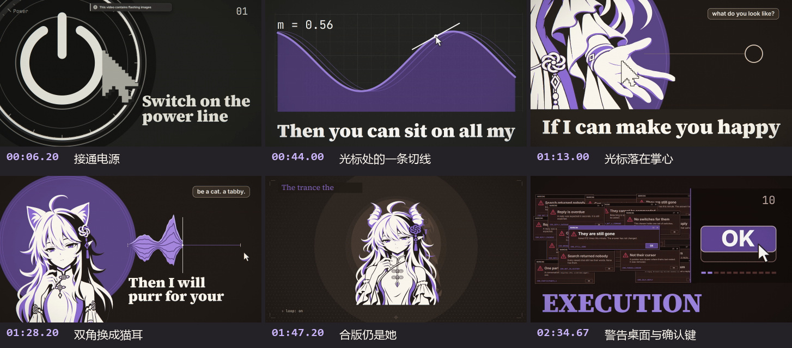

# 《world.execute(me);》制作手记与提示词

这支 Mili 同人歌词 MV 把两次副歌拍在同一只手上。第一次，用户的光标落进她的掌纹；最后一次，她发出的波形在空接点外等了半拍，又折回掌心。这里记录了从这两个动作，到播放器 2:59 穿过人物窗口，再到原生 4K 定稿的制作过程。

| 想找的内容 | 入口 |
| --- | --- |
| 顺着成片读制作过程 | [图文制作手记](MAKING_OF.md) · [12 页 PDF](guide.pdf) |
| 对着时间轴看片 | [播放器时间表](MAKING_OF.md#player-map) · [71 镜分镜](storyboard.md) |
| 复制提示词 | [十二条中文复现指令](PROMPTS.md) · [审片原话](MAKING_OF.md#user-quotes) |
| 按姿势找原始美术指令 | [角色重画](prompts/character-originals.md) · [服饰精修](prompts/costume-originals.md) |
| 看哪里改过 | [服饰](images/costume-comparison.png) · [掌心](images/palm-comparison.jpg) · [2:59 接镜](images/corridor-comparison.jpg) |
| 查代码和交付数字 | [绘制与导出摘录](examples/README.md) · [验收记录](records/delivery.md) |
| 下载封面 | [3840×2160 JPG](images/cover-4k.jpg) |

**定稿规格。** 3840×2160、60 fps，13,014 帧，画面时长 3:36.900。一般闪烁峰值 2.0 次/秒，饱和红 0，无单帧爆闪；音轨与原 WAV 偏移 0.00 ms。末 72 帧完全静止。

原曲为 Mili《world.execute(me);》。本作含 AI 生成内容。渲染工程和原角色剪影体系署名 Nyankomint，剪影及含人物的画面沿用 CC BY-NC-SA 4.0。[署名与许可](CREDITS.md) · [上游工程](https://github.com/Nyankomintsu/world-execute-me-lyric-mv)
